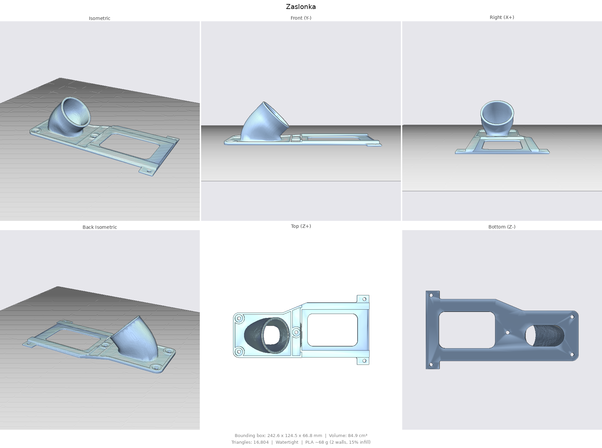

# leaf_zaslonka

Параметрична модель для 3D-друку: пластина з патрубком під гофру автономки
для Nissan Leaf, з окремою рамкою-бордюром зі сторони кузова, шторкою-засувом
і притискною планкою. Модель описана
кодом на [CadQuery](https://cadquery.readthedocs.io/).



## Деталі

| Файл | Деталь | Габарит, мм |
|---|---|---|
| `zaslonka.stl` | пластина з патрубком (овал 68.6 × 40 → коло Ø59.5, поворот 45°) | 242.6 × 124.5 × 66.8 |
| `zaslonka_frame.stl` | рамка: бордюр 3 × 4 зі сторони кузова, кільця під отвори | 242.6 × 124.5 × 4 |
| `zaslonka_shutter.stl` | шторка вікна 90 × 58.5 | 110 × 78.5 × 13 |
| `zaslonka_clamp.stl` | притискна планка з гніздом під гайку M6 | 20 × 90.1 × 10 |

Для друку - `print_*.stl`: ті самі деталі, збільшені на усадку 2%
(пластина 247.6 × 127.0 × 68.2 мм, влазить на стіл 256 × 256). Файли без префікса - номінальний розмір:
`.stl` для перегляду, `.step` для правок у CAD, `*_preview.png` - рендери.

## Встановлення

Потрібен Python 3.10-3.12.

```bash
python3 -m venv .venv
.venv/bin/pip install -r requirements.txt
```

## Збірка

```bash
.venv/bin/python zaslonka.py
```

Скрипт перезаписує `.stl`, `.step` і `print_*.stl` усіх чотирьох деталей і перевіряє посадку
шторки в напрямних (`mating.py`). Якщо шторка не тримається або деталі
перетинаються, збірка падає з `MatingError`.

Рендери `*_preview.png` скрипт не оновлює.

## Налаштування

Усі розміри - у блоці `PARAMETERS` на початку `zaslonka.py`. Змінити значення,
запустити збірку. Основні:

| Параметр | Значення | Що це |
|---|---|---|
| `edge_margin`, `end_margin` | 20 | відступ від отворів до краю пластини |
| `plate_t` | 3 | товщина пластини |
| `oval_h`, `oval_straight` | 40, 28.6 | овал патрубка біля пластини |
| `tube_od`, `tube_wall` | 59.5, 3 | зовнішній діаметр і стінка труби (стінка росте всередину) |
| `bend_angle`, `bend_r`, `outlet_len` | 45, 40, 20 | поворот, радіус по осі, пряма ділянка на виході |
| `bead_d`, `bead_w` | 60.5, 2 | буртик під хомут на кінці труби |
| `rib_in_w`, `rib_in_h` | 3, 2 | бордюр зі сторони труби |
| `rib_out_w`, `rib_out_h` | 3, 4 | бордюр зі сторони кузова |
| `stiff_gap` | 14 | відстань між ребрами жорсткості |
| `hole_d`, `ear_r`, `ear_extra` | 6, 7, 6 | кріпильні отвори, пів-ширина вух, подовження вух до центру |
| `win_len`, `win_w`, `win_r`, `win_gap` | 90, 58.5, 10, 44 | вікно і відстань від овалу |
| `fit_clearance` | 0.3 | зазор шторки в напрямних, на сторону |
| `grip_w`, `grip_h` | 3, 4 | ребро-ручка на шторці |
| `loop_*` | | вушко під дротяний гак на шторці |
| `clamp_t`, `nut_af`, `nut_h` | 3, 10, 5 | притискна планка, гніздо під гайку M6 |
| `shrinkage` | 0.02 | усадка при друку, тільки для `print_*.stl` |

### Усадка

`print_*.stl` збільшені в `1/(1 - shrinkage)` разів (при 0.02 - у 1.0204).
Під інший матеріал змінити `shrinkage` і перезібрати. Не вмикати одночасно
компенсацію усадки в слайсері.

## Друк

- Пластина: плитою вниз, трубою вгору, без підтримок під плитою.
- Рамка: плазом. У файлі два тіла: сама рамка і окрема шайба під середній
  отвір. Рамку і шайбу затискають між пластиною і кузовом кріпильні гвинти.
- Напрямні шторки мають скіс 45° і друкуються без підтримок.
- Шторка: плоскою стороною вниз.
- Планка: гніздом під гайку вгору; знизу міст 14 мм між ребрами.
